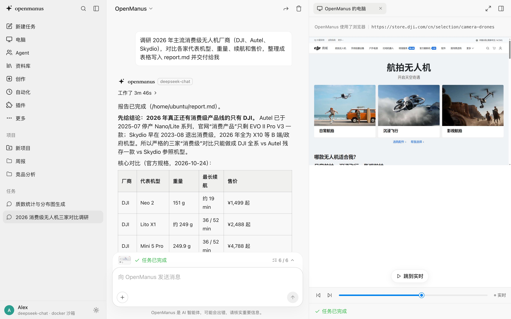
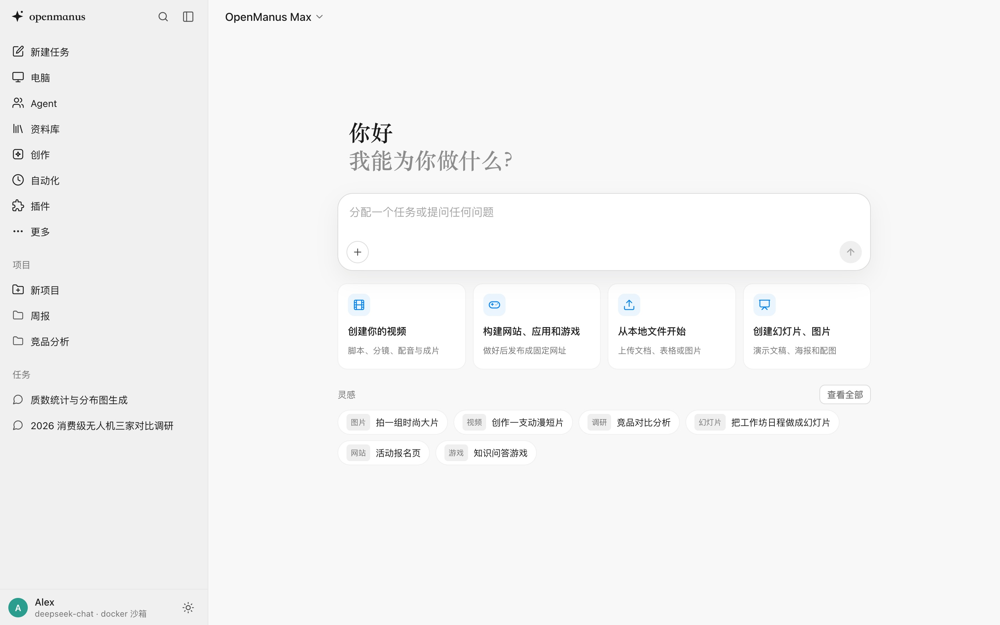
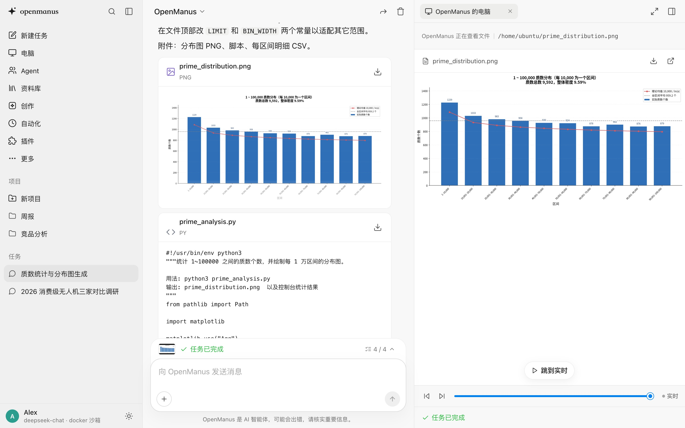
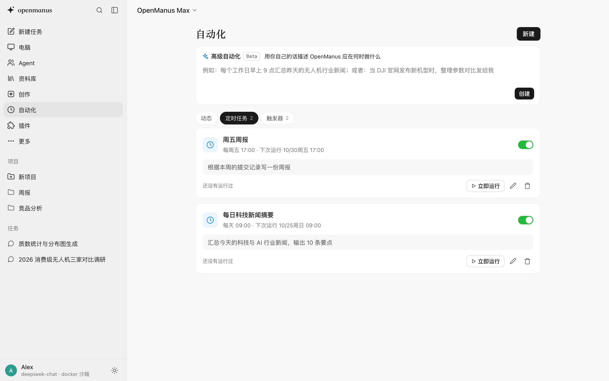
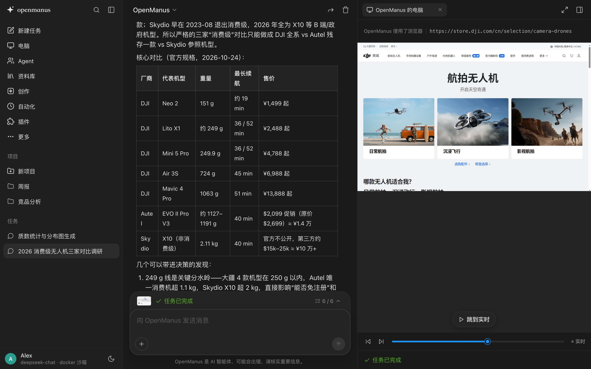

<div align="center">

# OpenManus

**类 Manus 的开源通用 Agent 平台**

给出任务，Agent 在独立的沙箱电脑里自己规划、搜索、浏览网页、写代码、跑命令，最后交付文件。


[](LICENSE)

[功能](#功能) · [界面预览](#界面预览) · [快速开始](#快速开始) · [配置](#配置) · [架构](#架构) · [开发](#开发) · [贡献](#贡献)



</div>

---

## 目录

- [简介](#简介)
- [界面预览](#界面预览)
- [功能](#功能)
- [快速开始](#快速开始)
- [配置](#配置)
- [使用](#使用)
- [架构](#架构)
- [项目结构](#项目结构)
- [开发](#开发)
- [安全](#安全)
- [贡献](#贡献)
- [许可证](#许可证)
- [致谢](#致谢)

## 简介

OpenManus 参照 [Manus](https://manus.im) 的架构做了一份 clean-room 实现。每个任务分配一台独立的沙箱电脑（Docker 容器），Agent 在里面按「分析 → 选工具 → 执行 → 观察 → 迭代 → 交付」的循环工作。前端实时展示每一步，并提供可回放、可接管的「电脑」面板。

实现原理分析（含 REA 逆向证据）见 [docs/ARCHITECTURE.md](docs/ARCHITECTURE.md)。

## 界面预览

<table>
  <tr>
    <td width="50%"></td>
    <td width="50%"></td>
  </tr>
  <tr>
    <td align="center"><b>首页</b>：输入任务，或从创作入口和灵感模板开始</td>
    <td align="center"><b>交付文件</b>：文件卡片可预览，电脑面板打开生成的图表</td>
  </tr>
  <tr>
    <td width="50%"></td>
    <td width="50%"></td>
  </tr>
  <tr>
    <td align="center"><b>自动化</b>：定时任务、条件触发和 Webhook</td>
    <td align="center"><b>深色主题</b>：跟随系统或手动切换</td>
  </tr>
</table>

> 截图中的任务由 `deepseek-chat` 在 Docker 沙箱中真实执行。

## 功能

### Agent 内核

- **Agent Loop**：分析事件 → 选择工具 → 沙箱执行 → 观察 → 迭代 → 交付 → idle
- **47 个工具**：`shell_*`、`file_*`、`browser_*`（元素编号加截图视觉）、`info_search_web`（一次并发 1–3 个查询）、`info_search_image`、`info_search_scholar`（OpenAlex）、`info_extract_webpage`、`deploy_*`、`message_*`、`plan_update`、`agent_map_reduce`、`agent_delegate`、`schedule_create`、`trigger_create`、`knowledge_save`、`slides_export`、`media_generate_*`、`email_*`、`phone_*`、`mcp_*`、`idle`
- **并行工具调用**：一轮里全是只读调用（搜索、网页提取、读文件）时并发执行
- **Planner**：用结构化输出生成计划；可开启「执行前确认计划」，逐行修改或用自然语言要求重新规划
- **Wide Research**：`agent_map_reduce` 并行派发同构子代理；运行中可停止、重试单个子任务或强制继续，重跑时复用已完成项
- **上下文工程**：静态前缀加 prompt caching、只追加的历史、按前缀遮蔽工具、可恢复压缩（大观察结果落盘到沙箱）、保留错误、复述计划
- **交付语义**：`opening` / `progress` / `result` 三类交付；结束后生成追问建议和下一步操作推荐（做成网页、幻灯片、数据看板等）
- **流式与排队**：回复和工具参数边生成边推送；任务运行中的新消息可排队或直接插话

### 沙箱与电脑

- **会话沙箱**：每个会话一个 Docker 容器（Ubuntu + Python + Node + Chromium），通过动作 API 控制；提供端口预览代理，时区与服务器一致；空闲（默认 15 分钟）且无人观看时自动停止，保留文件
- **实时画面与接管**：浏览器跑在 Xvfb 上，经 noVNC 推到「电脑」面板；用户可一键接管（登录、验证码）后交还 Agent
- **云电脑**：长期存在的机器，带模板（自动化、应用托管、Blender 渲染、游戏服务器等），可选 CPU / 内存与关机策略；支持桌面、终端、固定域名端口 `pc-<id>-<端口>.<域名>`，任务可指定在某台电脑上运行
- **连接本机**：在自己的电脑上运行 `device/openmanus_device.py`，通过主动发起的 WebSocket 隧道接入（本机不开放端口）；每条命令和每次写文件都先确认；加 `--my-browser http://127.0.0.1:9222` 后 Agent 直接用你的 Chrome 和登录状态

### 技能、插件与连接器

- **技能库**：官方技能（`backend/skills/`）、个人技能（手写、上传 SKILL.md/zip，或由 Agent 编写后一键收藏）、第三方技能（从 GitHub 导入）；可按消息指定技能。上下文里只放名称和触发说明，Agent 按需读取
- **技能录制器**：在云端浏览器或你自己的 Chrome 里演示一遍流程，模型把它整理成带参数的 SKILL.md 草稿（密码等敏感字段只记为「需询问用户」）
- **插件**：25 个预置 MCP 连接器（飞书、Notion、GitHub、高德/百度地图、Context7、DeepWiki、Stripe、Supabase、ElevenLabs、MiniMax 等），填写密钥即可使用
- **MCP 连接器**：支持 stdio / Streamable HTTP / SSE；工具不直接进工具表，Agent 用 `mcp_search_tools` 检索、`mcp_call_tool` 调用

### 创作

- **站点托管**：`deploy_publish` 把沙箱里的网站、游戏或应用发布到版本化存储，每个站点有独立域名 `<slug>.<域名>`，与主站不同源；可切换版本、下线
- **幻灯片**：内置模板（1280×720），`slides_export` 导出图片、矢量 PDF 和 PPTX（保留演讲者备注）
- **媒体生成**：经网关生成或编辑图片，生成后模型会自检缩略图；语音、视频生成按 OpenAI 兼容协议实现

### 自动化与集成

- **定时任务**：一次 / 间隔 / 每天 / 每周，到点新建任务
- **触发器**：条件触发（只读的观察者 Agent 定期查证，能识别「降价」「有新帖」这类变化）和 Webhook 触发；也可用自然语言描述「何时做什么」，由模型解析
- **Mail Manus**：配置 IMAP 后每封来信成为一个任务（附件上传到沙箱），配置 SMTP 后把结果回信给发件人
- **Agent 邮箱与电话**：`email_send` / `email_check` 收发邮件；接入 Twilio 后 `phone_sms` 发短信、`phone_call` 拨电话（每次发送都需确认）
- **飞书机器人**：在飞书里私聊或 @ 机器人派任务，完成后回到原会话回复
- **开发者 API**：在设置中创建 API 密钥，通过 `POST /api/v1/tasks`、`GET /api/v1/tasks/<id>`、`POST /api/v1/tasks/<id>/messages` 从脚本调用

### 协作与管理

- **Agent 与团队**：创建有专门职责的 Agent，并组建团队；负责人用 `agent_delegate` 把子任务并行派给成员，最后汇总交付
- **项目**：项目指令和项目文件，项目内的任务自动带上指令，文件复制到沙箱 `~/project/`
- **个性化**：昵称、职业、自定义指令对所有任务生效；长期「知识」可由 Agent 提议、用户确认；支持从其他 AI 导入记忆
- **多用户**：创建管理员后启用登录，数据按用户隔离，技能和插件组织共享；支持飞书登录
- **操作确认**：部署、推送、发布、对外发送、远程登录、大范围删除等操作会挂起，用户允许后才执行
- **分享回放**：生成可撤销的只读链接，访客可按原节奏回放工作日志和电脑面板
- **资料库与数据**：应用数据存于 `data/manus.db`（SQLite，旧版 JSON 文件首次启动时自动导入）；交付文件和上传另存到会话目录，容器删除后仍可下载；支持跨任务浏览筛选、导出全部数据或删除所有任务
- **用量统计与通知**：按任务、模型、日期统计运行时长、调用次数和 tokens（含缓存命中）；可开启桌面通知

### 模型与界面

- **模型**：`MANUS_LLM_PROVIDER` 选择模型提供商，默认 LiteLLM 网关（`claude-opus-5-5`），也可直连 OpenAI、Anthropic、Google、DeepSeek、Kimi、智谱、通义千问等或任意 OpenAI 兼容端点，统一以 OpenAI chat completions 协议调用；经 LiteLLM 时 `reasoning_effort` 映射为自适应思考，签名思考块在工具调用间回传，`cache_control` 做提示缓存
- **模式与 Flex**：Max / 标准 / Lite 三档；Flex 可用自己的密钥接 OpenAI、Anthropic、Google、xAI、DeepSeek、Kimi、智谱、通义千问、硅基流动、OpenRouter、Fireworks 或任意 OpenAI 兼容端点
- **界面**：按 Manus 2.0 网页端还原（布局、设计变量和交互经 REA/CDP 实测），含工作日志、文件预览、时间轴回放、计划进度条、浅色/深色主题；可安装为 PWA 在手机上使用
- **实时协议**：WebSocket 传输与 Manus 同构的事件（`chat` / `toolUsed` / `planUpdate` / `statusUpdate`），支持断线续传、运行中追加消息、向用户提问、停止后恢复；后端重启后，重启前正在运行的任务会自动接着跑（`MANUS_RESUME_TASKS`）

## 快速开始

### 前置要求

- Python 3.12+ 和 [uv](https://docs.astral.sh/uv/)
- Node.js 20+（构建 Web 界面）
- Docker（生产模式需要）
- 一个模型提供商的 API key（LiteLLM 网关、OpenAI、Anthropic、DeepSeek 等，或任意 OpenAI 兼容端点）

### 安装与运行

```bash
git clone https://github.com/Lzhtommy/rea-openmanus.git
cd rea-openmanus

# 1. 配置凭据
cp .env.example .env          # 至少填写 MANUS_LLM_PROVIDER 和 MANUS_LLM_API_KEY（litellm / custom 还需 MANUS_LLM_BASE_URL）
set -a; source .env; set +a

# 2. 构建 Web 界面（输出到 frontend/dist，由后端托管）
cd frontend && npm install && npm run build && cd ..
```

**方式 A：Docker 沙箱（推荐）**

```bash
docker build -t manus-sandbox:latest sandbox/
# 网络慢时可指定镜像源（均可选）：
#   --build-arg APT_MIRROR=mirrors.huaweicloud.com
#   --build-arg PIP_INDEX_URL=https://mirrors.huaweicloud.com/repository/pypi/simple
#   --build-arg PLAYWRIGHT_DOWNLOAD_HOST=https://cdn.npmmirror.com/binaries/playwright
cd backend && uv sync && uv run uvicorn app.main:app --port 8000
```

**方式 B：本地沙箱（仅供开发调试，命令直接在本机执行）**

```bash
cd sandbox && uv venv .venv \
  && uv pip install -p .venv/bin/python -r requirements.txt \
  && .venv/bin/python -m playwright install chromium
cd ../backend && uv sync && MANUS_SANDBOX=local uv run uvicorn app.main:app --port 8000
```

启动后打开 <http://localhost:8000>。

## 配置

所有配置都通过环境变量设置，参考 [`.env.example`](.env.example)。

### 核心

| 变量 | 默认值 | 说明 |
|---|---|---|
| `MANUS_LLM_PROVIDER` | `litellm` | 模型提供商：`litellm`、`openai`、`anthropic`、`google`、`xai`、`deepseek`、`moonshot`、`zhipu`、`qwen`、`siliconflow`、`openrouter`、`fireworks`，或 `custom`（任意 OpenAI 兼容端点，如 vLLM、Ollama、Azure） |
| `MANUS_LLM_BASE_URL` | 提供商的官方地址 | 端点地址；`litellm` 和 `custom` **必填**，其他提供商填了会覆盖默认地址 |
| `MANUS_LLM_API_KEY` | — | 该提供商的 API key（也可用 `LITELLM_API_KEY`），**必填** |
| `MANUS_MODEL` | 提供商的推荐模型 | 模型名（如 `gpt-5.1`、`deepseek-chat`；LiteLLM 默认 `claude-opus-5-5`） |
| `MANUS_MODEL_MAX` / `MANUS_MODEL_LITE` | 同 `MANUS_MODEL` | Max / Lite 模式使用的模型 |
| `MANUS_DEFAULT_MODE` | `standard` | 新任务默认模式 |
| `MANUS_REASONING` | `true` | 是否发送 `reasoning_effort` |
| `MANUS_EFFORT` / `MANUS_SUBAGENT_EFFORT` | `high` / `medium` | 主代理、子代理的推理强度 |
| `MANUS_PROMPT_CACHE` | `true` | 是否加 `cache_control` 缓存断点 |
| `MANUS_PUBLIC_URL` | `http://localhost:8000` | 生成链接时使用的外部地址 |
| `TAVILY_API_KEY` | 空 | 网页搜索；不设置时回退到 DuckDuckGo |

### 沙箱

| 变量 | 默认值 | 说明 |
|---|---|---|
| `MANUS_SANDBOX` | `docker` | `docker` 或 `local` |
| `MANUS_SANDBOX_MEMORY` / `MANUS_SANDBOX_CPUS` | `4g` / `2` | 容器资源限制 |
| `MANUS_SANDBOX_IDLE_MINUTES` | `15` | 空闲多久后停止，`0` 关闭回收 |
| `MANUS_SANDBOX_TZ` | 服务器时区 | 沙箱时区（POSIX TZ，例如 `<+08>-8`） |
| `MANUS_SITES_DOMAIN` | `MANUS_PUBLIC_URL` 的主机 | 已发布站点的域名后缀，需泛解析到本服务 |

### Agent 行为

| 变量 | 默认值 | 说明 |
|---|---|---|
| `MANUS_PLANNER` | `true` | 是否启用 Planner |
| `MANUS_CONFIRM` | `true` | 有外部影响的操作是否需要确认 |
| `MANUS_SUGGESTIONS` | `true` | 任务结束后是否生成追问建议 |
| `MANUS_RESUME_TASKS` | `true` | 后端重启后，是否自动继续重启前正在运行的任务（24 小时内的任务；连续中断 2 次后不再自动继续） |
| `MANUS_BROWSER_VISION` | `true` | 是否把浏览器截图发给模型 |
| `MANUS_OBSERVATION_LIMIT` | `12000` | 观察结果超过此字符数就落盘压缩 |
| `MANUS_WIDE_CONCURRENCY` / `MANUS_WIDE_MAX_TASKS` | `4` / `20` | Wide Research 并发数和子任务上限 |

### 可选能力

| 变量 | 说明 |
|---|---|
| `MANUS_IMAGE_MODEL` / `MANUS_TTS_MODEL` / `MANUS_VIDEO_MODEL` | 网关上的图片 / 语音 / 视频生成模型 |
| `MANUS_MAIL_IMAP_HOST` / `MANUS_MAIL_USER` / `MANUS_MAIL_PASSWORD` | Mail Manus 收信 |
| `MANUS_MAIL_SMTP_HOST` | Mail Manus 回信 |
| `MANUS_TWILIO_ACCOUNT_SID` / `_AUTH_TOKEN` / `_NUMBER` | Agent 电话（短信、语音） |
| `MANUS_FEISHU_APP_ID` / `MANUS_FEISHU_APP_SECRET` | 飞书登录与飞书机器人 |
| `MANUS_FEISHU_VERIFICATION_TOKEN` | 校验飞书事件 |
| `MANUS_FEISHU_AUTO_SIGNUP` | 新飞书用户是否自动开通账号 |
| `MANUS_AUTH` | 设为 `off` 强制单用户模式 |

## 使用

- **Web 界面**：打开首页输入任务即可；输入框的「+」菜单可指定技能、运行位置、执行前确认计划；旁边的连接器菜单可查看电话和邮箱、切换到「我的浏览器」，按个人开关单个连接器或接入插件
- **飞书机器人**：把飞书应用的事件订阅地址设为 `/api/integrations/feishu/events`（订阅 `im.message.receive_v1`）
- **API**：

  ```bash
  curl -X POST http://localhost:8000/api/v1/tasks \
    -H "Authorization: Bearer <API_KEY>" \
    -H "Content-Type: application/json" \
    -d '{"prompt": "调研 2026 年开源 Agent 框架并整理成表格", "mode": "standard"}'
  # → {"id": "...", "url": "...", "status": "..."}

  curl http://localhost:8000/api/v1/tasks/<id> -H "Authorization: Bearer <API_KEY>"

  curl -X POST http://localhost:8000/api/v1/tasks/<id>/messages \
    -H "Authorization: Bearer <API_KEY>" \
    -H "Content-Type: application/json" \
    -d '{"content": "再补充一列 GitHub star 数"}'
  ```

  API 密钥在「设置 → 开发者」中创建（`om_` 开头，只显示一次）；`mode` 可选 `max` / `standard` / `lite`。

## 架构

```
┌──────────────┐  WebSocket / HTTP  ┌──────────────────────────────┐   动作 API   ┌───────────────────┐
│ 前端 (React) │ ◀────────────────▶ │  后端 (FastAPI)               │ ◀──────────▶ │ 沙箱 (Docker)      │
│  工作日志     │   Manus 同构事件    │  Session · Agent Loop        │              │ shell · 文件       │
│  电脑面板     │                    │  Planner · 工具分发 · 压缩     │              │ Chromium + Xvfb   │
└──────────────┘                    └──────────────┬───────────────┘              └───────────────────┘
                                                   │ OpenAI 协议
                                            ┌──────▼──────┐
                                            │  模型提供商   │
                                            └─────────────┘
```

详细的设计说明和与 Manus 的对照见 [docs/ARCHITECTURE.md](docs/ARCHITECTURE.md)。

## 项目结构

```
backend/
  app/
    main.py         应用入口：启动与关闭、中间件（登录、站点域名、缓存）、挂载路由
    routes/         HTTP + WebSocket 路由，按功能分模块（任务、实时事件流、自动化、账户……）
    storage.py      持久化：data/manus.db（SQLite）和原子写文件
    config.py       环境变量配置
    session.py      会话：事件日志、LLM 历史、计划、收件箱、追问建议
    agent.py        Agent 循环、工具分发、可恢复压缩、Wide Research
    llm.py          模型客户端（Anthropic 块格式 ↔ OpenAI chat 格式）
    tools.py        动作空间定义（统一前缀、角色遮蔽、UI 分类）
    prompts.py      系统提示词、Planner 提示词、子代理说明
    sandbox.py      沙箱生命周期（Docker / 本地）和动作 API 客户端
    search.py       网页搜索（Tavily / DuckDuckGo）
    skills.py       技能加载与装入沙箱
    connectors.py   MCP 连接器
    plugins.py      预置插件目录
    scheduler.py    定时任务
    triggers.py     条件触发与 Webhook 触发
    projects.py     项目
    agents.py       自定义 Agent 与团队
    computers.py    云电脑
    devices.py      连接本机
    sites.py        站点托管
    media.py        图片 / 语音 / 视频生成
    recordings.py   技能录制器
    personal.py     个性化与知识
    providers.py    模式与 Flex 提供商
    auth.py         多用户与登录
    apikeys.py      开发者 API 密钥
    mail.py         Mail Manus 与 Agent 邮箱
    phone.py        Agent 电话（Twilio）
    feishu_bot.py   飞书机器人
  skills/           官方技能（<name>/SKILL.md）
  tests/            端到端测试
sandbox/            沙箱镜像（Dockerfile）和沙箱内动作 API 服务（server.py）
device/             连接本机用的设备端程序
frontend/           Web 界面（React + TypeScript + Vite，支持 PWA）
docs/               架构文档
```

## 开发

### 运行测试

```bash
cd backend && MANUS_SANDBOX=local uv run python -m pytest tests -q
```

测试使用脚本化模型，**不需要 API key**。它会启动真实的本地沙箱，覆盖全部工具类别、Planner、提问等待、并行子代理、可恢复压缩、停止后修复历史以及端口预览代理。

### 前端

Web 界面在 `frontend/`，使用 React 19 + TypeScript + Vite：

```bash
cd frontend
npm install
npm run dev        # http://localhost:5173，热更新；/api 和 WebSocket 代理到后端
npm run typecheck  # 类型检查
npm run build      # 生产构建，输出到 frontend/dist
```

开发服务器默认代理到 `http://127.0.0.1:8000`，可用 `OPENMANUS_BACKEND` 指定其他后端地址。后端默认托管 `frontend/dist`，可用 `MANUS_STATIC_DIR` 指向其他目录。

代码结构：

```
src/
  store.ts        全局状态与渲染调度（useStore / render / touch）
  events.ts       WebSocket 与事件模型（把事件流折叠成 turn 和 step）
  actions.ts      导航、数据加载和共享命令
  App.tsx         应用外壳；Chrome.tsx 是侧栏和顶栏
  session/        任务会话：工作日志、电脑面板、任务栏、输入框
  views/          各页面及其弹窗
  lib/            图标、工具函数、Markdown 渲染、noVNC 加载
```

## 安全

- `local` 模式下 Agent 的命令直接在宿主机执行，**只能用于开发**。
- Docker 模式下沙箱以非 root 用户运行（有 sudo），网络不受限；如需出网管控，请在容器网络层配置。
- 搜索等 API key 只保存在编排层，不会注入沙箱。
- 有外部影响的操作默认需要用户确认（`MANUS_CONFIRM`）。

发现安全问题时请私下联系维护者，不要公开提交 issue。

## 贡献

欢迎提交 issue 和 pull request：

1. Fork 本仓库并创建分支：`git checkout -b feature/your-feature`
2. 提交修改并确保测试通过
3. 推送分支并发起 pull request，说明改动内容和动机

## 许可证

本项目基于 [MIT License](LICENSE) 开源。

## 致谢

- [Manus](https://manus.im)：本项目参照的产品与架构
- [LiteLLM](https://github.com/BerriAI/litellm)、[FastAPI](https://fastapi.tiangolo.com/)、[Playwright](https://playwright.dev/)、[noVNC](https://novnc.com/)、[Model Context Protocol](https://modelcontextprotocol.io/)
